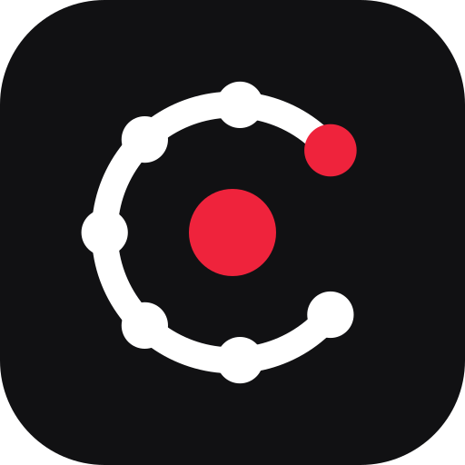
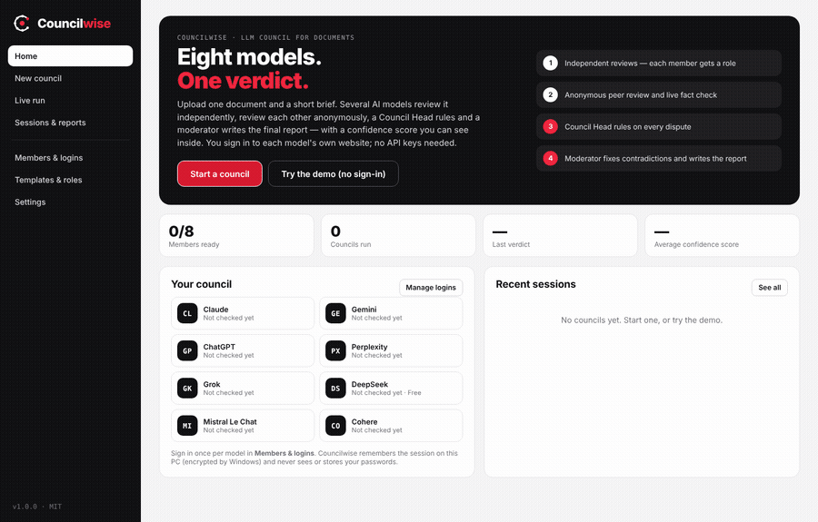
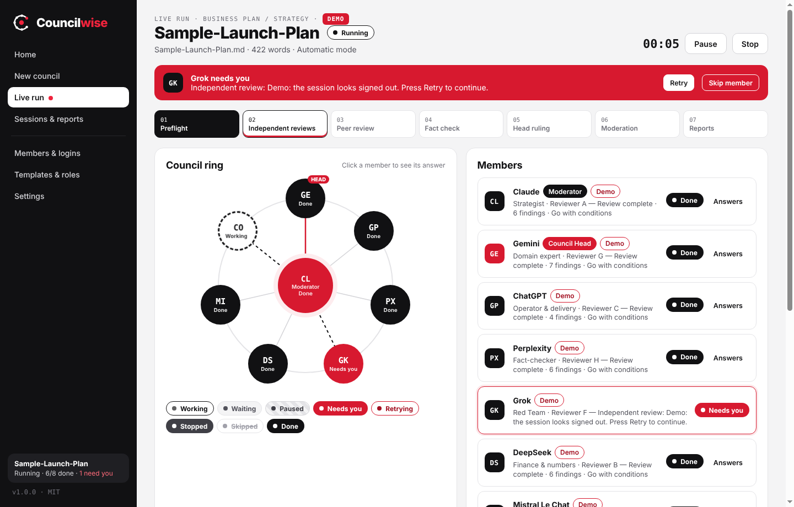
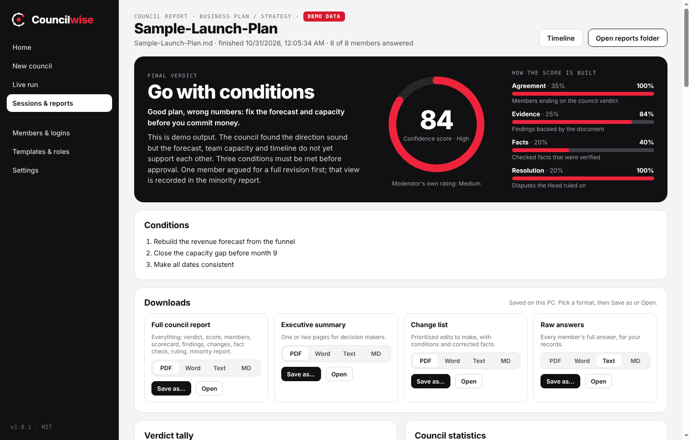
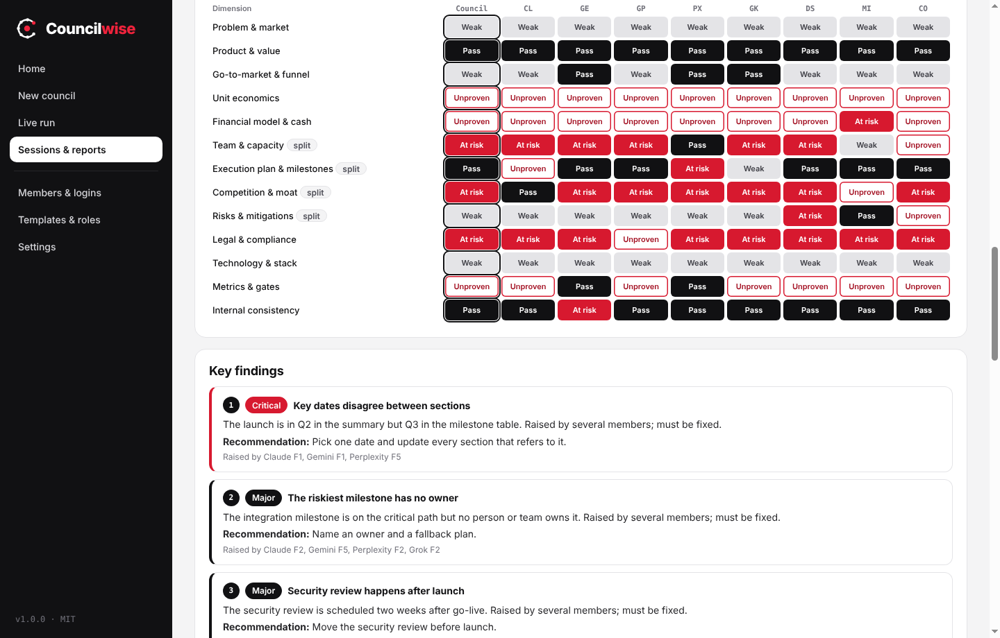
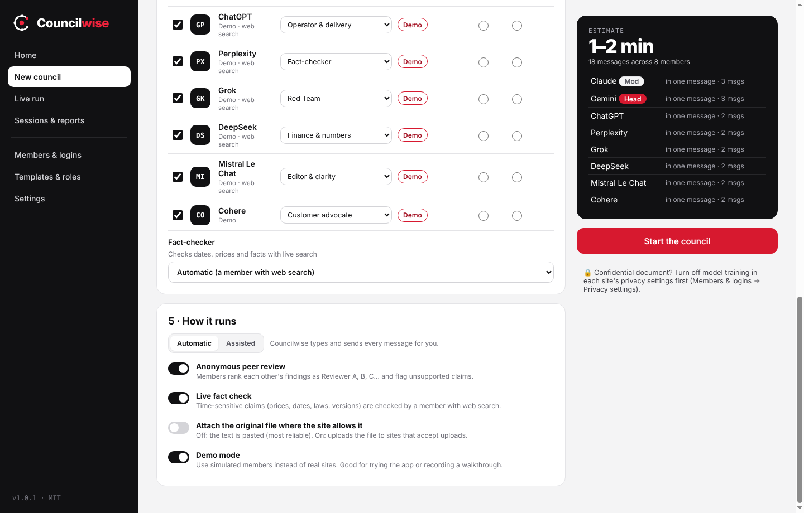
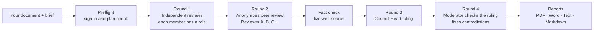

<p align="center">
  
</p>

<h1 align="center">Councilwise</h1>

<p align="center"><b>Eight models. One verdict.</b><br>
A Windows desktop app that runs an <b>LLM council</b> on your document: several AI models review it independently, review each other anonymously, a Council Head rules on every dispute, and a moderator writes the final report — with a confidence score you can see inside.</p>

<p align="center">
  <a href="https://github.com/Chalkduggo/councilwise/releases/latest"><b>Download for Windows</b></a> ·
  <a href="#quick-start">Quick start</a> ·
  <a href="#how-a-council-works">How it works</a> ·
  <a href="#the-confidence-score">Confidence score</a> ·
  <a href="#privacy-and-security">Privacy</a>
</p>

<p align="center">
  
  
  
</p>



---

## Why Councilwise

One AI model reviewing an important document gives you one opinion, with one model's blind spots. Councilwise turns that into a structured council:

- **You sign in, Councilwise does the work.** Log in once to each model's own website (Google sign-in and so on) inside the app. No API keys, no copy-paste, no tab juggling. Free and Pro plans both work, and the app shows which plan each member is on.
- **A real process, not a group chat.** Roles for every member, anonymous peer review, a live fact check, a Council Head ruling and an independent moderator — the same method an editorial or investment committee would use.
- **A verdict you can trust, or know not to.** A 0–100 confidence score built from agreement, evidence, verified facts and resolved disputes, with every part shown.
- **Finished reports.** Full council report, executive summary, change list and raw answers, as **PDF, Word, Text or Markdown**, with your own name and logo.
- **Built for long runs.** Live status for every member (working, paused, needs you, retrying, stopped, skipped, done), Pause, Stop and Resume, automatic retries, and a checkpoint after every step, so nothing is lost if a site or your PC hiccups.
- **Local and private.** Everything stays on your PC. Passwords are never seen or stored. No telemetry.

### How it compares

| | Councilwise | Karpathy's llm-council | ChatALL / GodMode | Hosted council apps |
|---|---|---|---|---|
| Uses your existing website logins (no API keys) | ✅ | ❌ (OpenRouter API) | ✅ | ❌ |
| Independent → peer review → chair synthesis | ✅ | ✅ | ❌ | ✅ |
| Roles, Council Head ruling **and** separate moderator | ✅ | ❌ | ❌ | ❌ |
| Live fact check of dates, prices and facts | ✅ | ❌ | ❌ | ❌ |
| Upload a document, get PDF / Word / Text reports | ✅ | ❌ | ❌ | partly |
| Transparent confidence score and scorecard | ✅ | ❌ | ❌ | partly |
| Pause / stop / resume from checkpoint | ✅ | ❌ | ❌ | ❌ |
| Windows app, runs locally, open source | ✅ | local web app | ✅ | ❌ |

Councilwise is built on the LLM-council idea from [Andrej Karpathy's llm-council](https://github.com/karpathy/llm-council) — see [Credits](#credits).

## Screenshots

| Live run: a member needs you | Final report |
|---|---|
|  |  |
| **Scorecard and disagreement map** | **Set up a council** |
|  |  |

## Quick start

1. **Download** `Councilwise-Setup-1.0.0.exe` from the [latest release](https://github.com/Chalkduggo/councilwise/releases/latest) and run it. (Prefer no install? Use `Councilwise-Portable-1.0.0.exe`.)
   Windows SmartScreen may warn that the app is from an unknown publisher, because the build is not code-signed. Choose **More info → Run anyway**.
2. **Try the demo first.** On Home, click **Try the demo**. A full council runs with simulated members on a sample document, so you can see every screen and report without signing in to anything.
3. **Sign in to your models.** Open **Members & logins**, click **Open & sign in** on each model, and log in. Tip: create a separate Gmail account for Councilwise and use "Continue with Google" everywhere — see [Before your first council](#before-your-first-council). Then click **Check sign-in & plan**.
4. **Start a council.** **New council** → drop in one file (Word, PDF, text or Markdown) → write a short brief → pick a review type → choose members, roles, the Council Head and the moderator → **Start the council**.
5. **Watch or walk away.** Several Chrome/Edge windows open, one per model, and the prompts are typed into them automatically — that's expected, just leave them open. The Live run screen shows every member's status. If a site needs you (expired sign-in, CAPTCHA), the member turns red, Windows notifies you, and the council waits. Fix it in the window and press **Retry**, or **Skip** that member.
6. **Read and download the report.** Verdict, confidence score, scorecard, key findings, change list, fact check, ruling, minority report — then **Save as** PDF, Word, Text or Markdown.

## Before your first council

A few tips that make the first run smooth:

- **Use a separate Google account (recommended).** Create a fresh Gmail account just for Councilwise and use it to sign in to every model (most AI sites offer "Continue with Google"). It takes a couple of minutes, keeps your everyday account separate, and makes signing in to all eight models a one-click job. You can still use your main account if you prefer, for example to use a Pro plan you already pay for.
- **Sign in to every member before you start.** Members & logins → **Open & sign in** on each model → **Check sign-in & plan**. Each should say *Signed in*.
- **Expect several browser windows to open.** During a run, Councilwise opens one Chrome/Edge window per model and types the prompts into them. That is normal — don't close them, and you don't need to touch them. You can put them behind other windows or carry on with your work.
- **Councilwise uses its own browser profile.** The Chrome/Edge windows it opens are separate from your everyday browser, so your normal bookmarks, tabs and accounts are not affected.
- **Confidential documents:** turn off model training in each site's privacy settings first.

## How a council works



- **Round 1 — Independent reviews.** Every member reviews the document on its own, with its own role (Strategist, Skeptic, Finance, Legal, Fact-checker, Customer, Engineer, Red Team…). Each finding must cite the document. Time-sensitive claims go on a list to check.
- **Round 2 — Anonymous peer review.** Members see each other only as Reviewer A, B, C, in shuffled order, so they judge evidence, not brand names. They rank each other, dispute findings and flag unsupported claims, then may update their verdict.
- **Fact check.** A member with live web search checks the flagged dates, prices, laws and figures.
- **Round 3 — Council Head ruling.** The Head groups the findings into issues and rules on each one (upheld, modified, rejected), sets the conditions, and keeps a minority report.
- **Round 4 — Moderation.** A second model checks the ruling against the evidence and the fact check, fixes contradictions (each fix is listed), and writes the final content.

Long documents are split into parts automatically to fit each site's message limit. Answers come back with a structured block at the end, so the app can compare members precisely; if a model forgets the format, the app asks once for a fix.

### Review templates

General document · Business plan / strategy · Contract or policy · Research paper · Pitch deck · Code or technical design · Resume or profile · Decision ("should I do X?"). Each sets the scorecard and default roles. You can add your own — see [docs/TEMPLATES.md](docs/TEMPLATES.md).

## The confidence score

The score is calculated by the app from the council's own data, never taken from a single model:

| Part | Weight | What it measures |
|---|---|---|
| Agreement | 35% | Members whose final verdict matches the council verdict (one step away counts half) |
| Evidence | 25% | Findings that cite the document and were not flagged as unsupported by two or more peers |
| Facts | 20% | Checked facts that were verified (left out when no fact check ran) |
| Resolution | 20% | Peer-review disputes the Council Head explicitly ruled on |

75–100 is **High**, 50–74 **Medium**, below 50 **Low**. The moderator's own confidence rating is shown next to it, so you can see when the two disagree.

## Connecting members

| Connection | When to use it |
|---|---|
| **My Chrome/Edge** (default) | Opens each member in a window of your real Chrome or Edge, with a separate Councilwise profile. Sign in once, including with Google; the session is remembered. Your everyday browser profile is never touched. |
| **Built-in window** | Same, inside Councilwise itself. Some sign-in pages (Google in particular) refuse embedded windows; use My Chrome/Edge for those. |
| **API key** (optional) | Steadier and faster, billed by the provider. Any OpenAI-compatible endpoint works, including OpenRouter and a local [Ollama](https://ollama.com) server. |
| **Demo** | Simulated answers, clearly labelled as demo data. Good for trying the app and for recordings. |

Built-in members: Claude, Gemini, ChatGPT, Perplexity, Grok, DeepSeek, Mistral Le Chat and Cohere. You can add any other chat website as a custom member.

**Automatic or Assisted.** In Automatic mode Councilwise types and sends every message. In Assisted mode it fills in each message and you press Send yourself in each window.

**When a site changes.** Each website is described by a small JSON *connector* (where the message box, Send button and answer are). If a site redesign breaks one, you can switch that member to API, or drop an updated connector into the connector folder without waiting for a new release. See [docs/CONNECTORS.md](docs/CONNECTORS.md).

## Privacy and security

- Everything (sessions, reports, settings) is stored on your PC only, in `%APPDATA%\Councilwise`.
- Members run in a dedicated Councilwise browser profile (in Chrome/Edge or the built-in windows), separate from your everyday browsing. Your password goes only to each model's own sign-in page; Councilwise never sees or stores it. Cookies and API keys are encrypted with Windows DPAPI.
- Your document is sent only to the models you choose. Councilwise works on a copy; your original file is never changed.
- No accounts, no analytics, no telemetry.
- **Confidential documents:** turn off model training in each site's privacy settings first (Members & logins → Privacy settings).

See [SECURITY.md](SECURITY.md) to report a vulnerability.

## Please read: website terms

Councilwise drives the websites you are signed in to, much like a very fast assistant using your browser. Some providers' terms restrict automated use of their consumer apps. You are responsible for how you use your accounts. If that matters for you, use **Assisted mode** (you press Send) or connect that member with an **API key**. Councilwise is not affiliated with or endorsed by Anthropic, Google, OpenAI, Perplexity, xAI, DeepSeek, Mistral AI or Cohere; their names are used only to identify the services you connect.

## Build from source

Requirements: Node.js 20+ and Git, on Windows 10/11 (macOS and Linux work for development).

```bash
git clone https://github.com/Chalkduggo/councilwise.git
cd councilwise
npm install
npm run demo          # run the app in demo mode
npm start             # run normally
npm test              # unit tests, including a full simulated council
npm run test:e2e      # launches the app and runs a complete demo council
npm run dist:win      # build the Windows installer and portable app into dist/
```

Releases are built automatically by GitHub Actions when a version tag (for example `v1.0.0`) is pushed — see [.github/workflows/release.yml](.github/workflows/release.yml).

### Project structure

```
src/main/            Electron main process
  main.js            app start, windows, sessions, IPC
  members.js         members, login windows, plan detection, connections
  browser.js         "My Chrome/Edge": a real browser window per member, driven over the DevTools protocol
  adapters/engine.js website automation (type, send, wait, read the answer)
  adapters/sites/    one JSON connector per website
  api.js             optional OpenAI-compatible API client
  demo.js            simulated members for the demo
  council/           prompts, parser, scoring, orchestrator (rounds, retries, checkpoints)
  reports/           report model + PDF / Word / Text / Markdown renderers
src/renderer/        the user interface (no framework, no build step)
templates/           review templates and the role library
test/                unit tests, engine test with a mock chat site, app end-to-end test
```

## Roadmap

- **1.1** — tracked-changes Word output (the revised document with every change marked), masking of names, emails and numbers before sending, compare two sessions.
- **1.2** — local models out of the box, community template gallery, command-line runner.
- **2.0** — member reliability over time (which models were right most often), shared councils for teams.

Ideas and votes are welcome in [Issues](https://github.com/Chalkduggo/councilwise/issues).

## Contributing

Contributions are very welcome, especially connector fixes when a site changes, new templates and translations. Read [CONTRIBUTING.md](CONTRIBUTING.md) to get started.

## Credits

- **The idea comes from Andrej Karpathy's [llm-council](https://github.com/karpathy/llm-council).** His project showed the method: several models answer independently, review each other's answers anonymously, and a chairman model writes the final answer. Councilwise is built on that idea and extends it for documents — website logins instead of API keys, roles for each member, a separate Council Head and moderator, live fact-checking, a transparent confidence score, live status with pause/resume, and PDF/Word reports. Councilwise is an independent project and is not affiliated with or endorsed by Andrej Karpathy.
- Tools such as [ChatALL](https://github.com/sunner/ChatALL) and GodMode showed that one app can talk to many chat websites through your own logins.
- Built with [Electron](https://www.electronjs.org), [mammoth](https://github.com/mwilliamson/mammoth.js), [pdf-parse](https://gitlab.com/autokent/pdf-parse) and [docx](https://github.com/dolanmiu/docx).

## Licence

[MIT](LICENSE) © 2026 Suman Mondal
